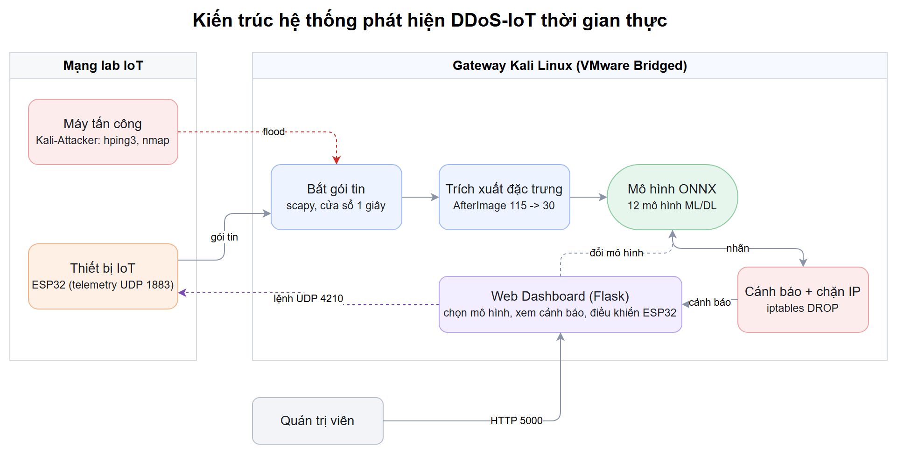
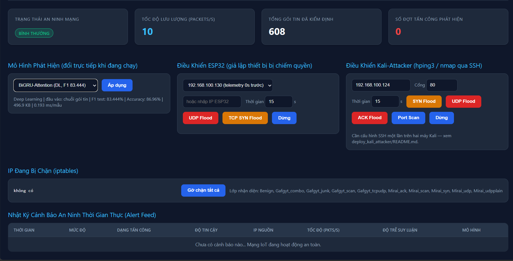

# Phát hiện tấn công DDoS trên IoT bằng Học sâu

Hệ thống phát hiện botnet IoT (Mirai, Gafgyt/BASHLITE) phát động tấn công DDoS, huấn
luyện trên hai bộ dữ liệu thật (N-BaIoT, CIC-IoT-2023) và triển khai thời gian thực
trên một gateway Kali Linux: bắt gói tin, trích xuất đặc trưng, suy luận bằng mô hình
đã huấn luyện, cảnh báo và tự động chặn IP — có giao diện web điều khiển được.



## Tính năng chính

- **5 mô hình học máy** (Decision Tree, KNN, Random Forest, XGBoost, SVM) và **7 mô
  hình học sâu** (MLP, 1D-CNN, Edge-CNN, LSTM, GRU, BiGRU, BiGRU-Attention), huấn
  luyện và so sánh trên cùng quy trình chống rò rỉ dữ liệu.
- **Trích xuất đặc trưng AfterImage** (115 đặc trưng, theo N-BaIoT/Kitsune) cài đặt
  lại để chạy trực tiếp trên gói tin bắt được, không cần công cụ ngoài.
- **Engine giám sát thời gian thực**: gom gói theo cửa sổ 1 giây, suy luận bằng
  ONNX Runtime, cảnh báo và tự động chặn IP bằng `iptables`.
- **Web Dashboard**: đổi thuật toán phát hiện ngay khi đang chạy (12 mô hình, không
  cần khởi động lại), điều khiển tấn công demo từ thiết bị IoT thật (ESP32) và từ
  máy Kali-Attacker thứ hai (qua SSH, lệnh bị giới hạn chặt).



## Kết quả (tập test, sau khi loại bỏ rò rỉ dữ liệu)

| Bộ dữ liệu | ML tốt nhất | DL tốt nhất |
|---|---|---|
| N-BaIoT (9 lớp đánh giá) | Decision Tree — F1-macro 86,08% | LSTM — F1-macro 86,28%, Accuracy 88,22% |
| CIC-IoT-2023 (8 lớp) | XGBoost — F1-macro 79,59%, Accuracy 81,41% | 1D-CNN — F1-macro 77,40% |

Mô hình dùng để triển khai thời gian thực là bộ mô hình N-BaIoT (đặc trưng AfterImage
tái tạo được trực tiếp từ gói tin); CIC-IoT-2023 chỉ dùng để đối chiếu offline vì đặc
trưng của nó không tái tạo được từ lưu lượng bắt trực tiếp. Mô hình mặc định khi chạy
demo là **BiGRU-Attention**; dashboard cho đổi sang 11 mô hình khác bất kỳ lúc nào
(KNN không có trong danh sách vì không xuất được sang ONNX).

## Cấu trúc thư mục

```
├── src/
│   ├── iot_datasets/       # Bộ nạp dữ liệu N-BaIoT và CIC-IoT-2023
│   ├── preprocess.py       # Tiền xử lý: chọn đặc trưng, chuẩn hóa, cân bằng lớp
│   ├── models/             # Mô hình học máy (baselines.py) và học sâu (deep.py)
│   ├── run_experiments.py  # Huấn luyện, đánh giá, xuất ONNX
│   ├── improve_dl.py       # Thử nghiệm cải thiện mô hình học sâu
│   └── realtime/           # afterimage.py, detection_engine.py, web_dashboard.py, mitigation.py
├── deploy_kali/            # Script cài đặt + khởi động trên Gateway, gói mô hình ONNX
├── deploy_kali_attacker/   # Script điều khiển tấn công từ xa (qua SSH) cho máy Kali-Attacker
├── deploy_esp32/           # Firmware Arduino cho ESP32 (thiết bị IoT giả lập)
├── run_pipeline.py         # Chạy toàn bộ pipeline huấn luyện từ đầu
└── docs/                   # Tài liệu cài đặt và demo
```

Thư mục `datasets/`, `data/`, `results/`, `backup/`, `captures/` không có trong repo
(xem [.gitignore](.gitignore)) vì chứa dữ liệu thô, mô hình trung gian hoặc bằng
chứng lab dung lượng lớn. Bộ mô hình ONNX dùng để chạy demo đã có sẵn trong
`deploy_kali/model/`.

## Bắt đầu

Xem **[docs/DEMO_GUIDE.md](docs/DEMO_GUIDE.md)** để cài đặt và chạy demo thời gian
thực từ đầu đến cuối (Gateway Kali, Kali-Attacker, ESP32, 4 kịch bản tấn công).

Muốn huấn luyện lại mô hình từ đầu: tải N-BaIoT và CIC-IoT-2023 (nguồn trong
`src/iot_datasets/`) vào `datasets/`, cài `requirements.txt`, rồi chạy:

```bash
python run_pipeline.py --all
```

## Nhóm thực hiện

Đỗ Vũ Đức Duy · Lê Đức Việt
