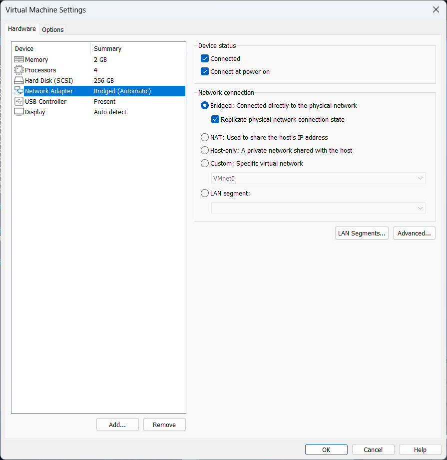
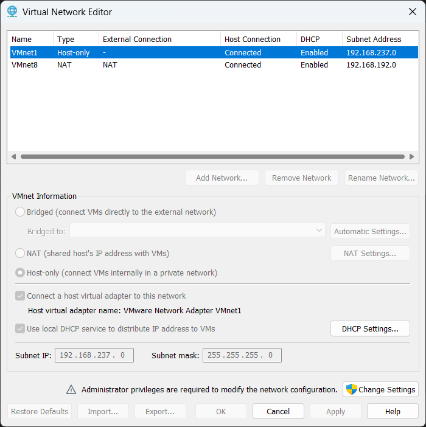
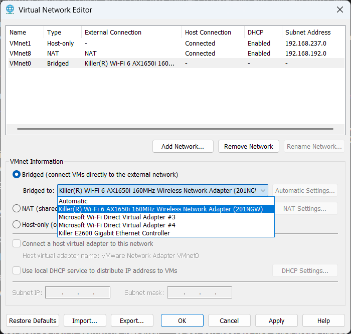

# Hướng dẫn cài đặt và chạy demo

Tài liệu này giả định máy đã có sẵn:

- **Một máy ảo Kali Linux** (VMware Workstation/Player) — sẽ dùng làm **Gateway**,
  và nhân bản thêm một máy nữa làm **Kali-Attacker** (Mục 2).
- **Arduino IDE** đã cài sẵn trên máy Windows/host.
- Một mạch **ESP32 DevKit V1** (hoặc tương đương) nối qua cáp USB.

---

## 1. Chuẩn bị mạng (Bridged)

Hai máy ảo Kali và ESP32 phải nằm **cùng một mạng LAN thật** (không dùng NAT), để
Gateway bắt được đúng gói tin có IP nguồn thật.

1. Bật một mạng **Wi-Fi 2,4 GHz** (hotspot hoặc router) — ESP32 chỉ hỗ trợ 2,4 GHz.

2. Mở **VM → Settings → Network Adapter**. Mặc định VMware thường để
   **"Bridged (Automatic)"**:

   

   Chế độ "Automatic" để VMware tự chọn card mạng để bắc cầu — trên máy có nhiều
   card (Wi-Fi, Ethernet, card ảo của VPN/Bluetooth...) nó hay chọn nhầm card chết
   hoặc card không có mạng, khiến máy ảo "có vẻ như có mạng" (vẫn nhận IP) nhưng
   không ra Internet được. Nên luôn chọn **"Custom: Specific virtual network"** và
   trỏ đích danh vào một mạng Bridged (bước 3–5).

3. Mở **Edit → Virtual Network Editor → Change Settings** (cần quyền Admin, bấm vào
   biểu tượng khiên nếu được hỏi). Nhiều máy mặc định **không có sẵn mạng Bridged
   nào** trong danh sách, chỉ có Host-only và NAT:

   

4. Bấm **Add Network...**, chọn một tên còn trống (ví dụ VMnet0), rồi chọn radio
   **"Bridged (connect VMs directly to the external network)"**. Ở ô **"Bridged
   to:"**, bấm dropdown và chọn **đúng tên card Wi-Fi của laptop** (không để
   "Automatic"):

   

   Bấm **Apply → OK**.

5. Quay lại **VM → Settings → Network Adapter** của **từng máy ảo Kali**: chọn
   **"Custom: Specific virtual network"**, ở dropdown chọn đúng mạng vừa tạo
   (VMnet0) → **OK**.

6. Nếu card Wi-Fi dùng chip **Killer** (Killer Wi-Fi 6/6E...) và vẫn không có
   mạng sau các bước trên: mở **Control Panel → Network Connections**, chuột phải
   card Wi-Fi → **Properties**, tick vào **"VMware Bridge Protocol"** nếu đang bỏ
   trống.

7. Kiểm tra trên **từng máy Kali**:

   ```bash
   ip -4 addr show eth0
   ping -c 3 1.1.1.1
   ```

   `ping` phải có phản hồi. Nếu `ip addr` không ra IP hoặc ra dạng `169.254.x.x`,
   quay lại bước 2–6. Nếu có IP nhưng `ping` không phản hồi và lệnh `apt update`
   báo `Temporary failure resolving ...`, đó là dấu hiệu mạng Bridged vẫn sai card
   (không phải lỗi DNS riêng lẻ) — kiểm tra lại bước 4 và 6.

---

## 2. Từ một máy Kali thành hai máy (nhân bản làm Kali-Attacker)

Nhân bản (clone) máy Kali đã cài sẵn là cách nhanh nhất để có máy thứ hai, thay vì
cài mới từ đầu.

1. **Tắt hẳn máy ảo Kali gốc** (Power Off, không chỉ Suspend) — VMware không cho
   full clone một máy đang chạy.
2. Trong VMware Library, chuột phải vào máy Kali gốc → **Manage → Clone...**
3. Chọn **"Clone from: The current state in the virtual machine"** → Next.
4. Chọn **"Create a full clone"** (khuyên dùng — máy độc lập hoàn toàn, không phụ
   thuộc máy gốc; "Linked clone" nhẹ hơn nhưng cần máy gốc còn tồn tại mãi).
5. Đặt tên, ví dụ `Kali-Attacker`, chọn nơi lưu → **Finish**. Clone một ổ đĩa
   20–30 GB mất vài phút.
6. Bật máy `Kali-Attacker` vừa clone, vào **VM → Settings → Network Adapter**,
   trỏ vào **đúng mạng Bridged** đã tạo ở Mục 1 (giống máy Gateway).
7. Trên `Kali-Attacker`, đổi tên máy và làm mới khóa SSH / IP — vì clone sao chép
   y hệt máy gốc, hai máy có thể bị trùng `machine-id`/khóa SSH gây lỗi khó hiểu
   khi hai máy cố gắng kết nối lẫn nhau:

   ```bash
   sudo hostnamectl set-hostname attacker
   sudo rm -f /etc/ssh/ssh_host_*
   sudo dpkg-reconfigure openssh-server
   sudo systemctl restart NetworkManager   # hoặc khởi động lại máy ảo
   ip -4 addr show eth0                    # xác nhận IP khác máy Gateway
   ```

8. Ghi lại IP của cả hai máy (`ip -4 addr show eth0` trên từng máy) — sẽ dùng
   xuyên suốt các mục sau. Gọi chúng là `<IP-Gateway>` và `<IP-Attacker>`.

---

## 3. Đưa mã nguồn vào máy ảo

Chọn một trong hai cách dưới đây. Chỉ cần làm cho **Kali Gateway**; phần
`deploy_kali_attacker/` còn cần chép riêng sang **Kali-Attacker** ở Mục 5.

### Cách A — VMware Shared Folder (không cần biết IP trước)

1. Chuột phải máy ảo (máy tắt hoặc đang chạy đều được với bản Workstation/Player
   mới) → **Settings → Options → Shared Folders** → chọn **"Always enabled"** →
   **Add...** → trỏ tới thư mục dự án trên Windows (thư mục đã `git clone` về).
2. Trong Kali, cài công cụ đọc shared folder nếu chưa có, rồi khởi động lại:

   ```bash
   sudo apt update
   sudo apt install -y open-vm-tools open-vm-tools-desktop
   sudo reboot
   ```

3. Sau khi khởi động lại, thư mục chia sẻ nằm ở `/mnt/hgfs/<tên-thư-mục>`. Chỉ
   chép đúng phần cần (bỏ qua `datasets/`, `data/`, `results/` — không cần cho
   demo):

   ```bash
   mkdir -p ~/ddos_iot
   cd /mnt/hgfs/<tên-thư-mục-dự-án>
   cp -r check_env.py requirements-kali.txt src deploy_kali ~/ddos_iot/
   ```

### Cách B — SCP qua mạng (biết IP, đã bật SSH)

Trên Kali Gateway, bật SSH:

```bash
sudo systemctl enable --now ssh
```

Trên Windows (PowerShell), từ thư mục dự án:

```powershell
ssh kali@<IP-Gateway> "mkdir -p ~/ddos_iot"
scp check_env.py requirements-kali.txt kali@<IP-Gateway>:~/ddos_iot/
scp -r src deploy_kali kali@<IP-Gateway>:~/ddos_iot/
```

Nếu PowerShell báo `ssh`/`scp` không phải lệnh, bật OpenSSH Client:
`Add-WindowsCapability -Online -Name OpenSSH.Client~~~~0.0.1.0`.

---

## 4. Cài đặt Gateway

Trên **Kali Gateway**:

```bash
cd ~/ddos_iot/deploy_kali
chmod +x setup_kali.sh start_monitor.sh
sudo ./setup_kali.sh
```

Script cài `scapy`, `iptables`, `tcpdump`, thư viện Python suy luận (ONNX Runtime,
Flask), bật IP forwarding, và kiểm tra gói mô hình (`model/registry.json`) đã có
sẵn trong `deploy_kali/`.

---

## 5. Cài đặt Kali-Attacker (để bấm tấn công ngay trên dashboard)

Chép `deploy_kali_attacker/` sang Kali-Attacker bằng một trong hai cách ở Mục 3
(Shared Folder hoặc `scp -r deploy_kali_attacker kali@<IP-Attacker>:~/ddos_iot/`).

Nếu chỉ cần chạy tay `hping3`/`nmap` thì có thể bỏ qua phần SSH dưới đây và làm
thủ công ở Mục 8. Để bấm nút trên dashboard, làm theo đúng
**[deploy_kali_attacker/README.md](../deploy_kali_attacker/README.md)** — tóm tắt:

1. Trên Kali-Attacker: cài `attack_runner.sh` vào `/opt` + quyền `sudo` giới hạn,
   chép `attack_wrapper.sh` vào thư mục home.
2. Trên Kali Gateway: tạo khóa SSH riêng cho việc này.
3. Trên Kali-Attacker: thêm khóa vào `authorized_keys` với **forced command** (khóa
   chỉ được phép chạy đúng `attack_wrapper.sh`, không chạy được lệnh tùy ý).
4. Thử kết nối từ Gateway, phải thấy `started ...` và không hỏi mật khẩu.

Cài thêm công cụ tấn công trên Kali-Attacker:

```bash
sudo apt update
sudo apt install -y hping3 nmap openssh-server
sudo systemctl enable --now ssh
```

---

## 6. Nạp firmware cho ESP32

1. Cắm ESP32 vào máy Windows qua USB.
2. Mở `deploy_esp32/esp32_iot_node/esp32_iot_node.ino` bằng Arduino IDE.
3. Nếu chưa có board ESP32: **File → Preferences**, thêm URL Board Manager:
   `https://raw.githubusercontent.com/espressif/arduino-esp32/gh-pages/package_esp32_index.json`,
   sau đó **Tools → Board Manager** cài gói `esp32 by Espressif`.
4. Sửa 3 dòng cho khớp mạng và IP Gateway thật của bạn:
   ```cpp
   const char* ssid = "<tên Wi-Fi 2,4 GHz>";
   const char* password = "<mật khẩu Wi-Fi>";
   const char* gateway_ip = "<IP-Gateway>";
   ```
5. **Tools → Board**: chọn **ESP32 Dev Module**. **Tools → Port**: chọn đúng cổng
   COM. Bấm **Upload**.
6. Mở **Serial Monitor** (115200 baud), phải thấy:
   ```
   [V] Ket noi thanh cong vao Kali Gateway!
   [NORMAL] Gui telemetry #1 ...
   ```

Chi tiết và cách điều khiển tấn công từ Serial Monitor: xem
[deploy_esp32/README.md](../deploy_esp32/README.md).

---

## 7. Khởi động giám sát và mở dashboard

Trên **Kali Gateway**:

```bash
cd ~/ddos_iot/deploy_kali
sudo iptables -F INPUT
export ATTACKER_HOST=<IP-Attacker>   # bỏ qua nếu không làm Mục 5
sudo -E ./start_monitor.sh eth0 5000 --block
```

Phải thấy đúng các dòng:

```
[ENGINE] Own IPs (never alerted/blocked): ...
[STARTUP] Model ONNX: .../deploy_kali/model/registry.json
[ENGINE] Monitoring with BiGRU-Attention | window 1.0s | ...
```

Trên Windows, mở trình duyệt: `http://<IP-Gateway>:5000`.

Nếu lưu lượng bình thường (router, mDNS...) gây cảnh báo giả, thêm tham số
`--local-ip <IP-cần-bỏ-qua>` (lặp lại được nhiều lần) khi khởi động, ví dụ:

```bash
sudo -E python3 ../src/realtime/web_dashboard.py --interface eth0 --port 5000 \
    --block --local-ip 192.168.1.1
```

---

## 8. Bốn kịch bản demo

Trước mỗi kịch bản, bấm **"Gỡ chặn tất cả"** trên dashboard (hoặc
`sudo iptables -F INPUT`) để màn hình gọn.

### Kịch bản 1 — Lưu lượng bình thường
Để ESP32 chạy yên 1–2 phút. Kỳ vọng: thẻ trạng thái **BÌNH THƯỜNG**, **0 cảnh báo**.

### Kịch bản 2 — UDP Flood từ ESP32
Khung "Điều Khiển ESP32": chọn IP ESP32, đặt số giây (ví dụ 15), bấm **UDP Flood**.
Kỳ vọng: cảnh báo `Mirai_udpplain`, độ tin cậy trên 98%, IP ESP32 bị chặn.

### Kịch bản 3 — SYN Flood từ Kali-Attacker
Khung "Điều Khiển Kali-Attacker": nhập IP Attacker (nếu chưa tự điền), bấm
**SYN Flood**. Không có khung này (bỏ qua Mục 5) thì chạy tay trên Kali-Attacker:

```bash
sudo timeout 15s hping3 -S -p 80 --flood <IP-Gateway>
```

Kỳ vọng: có cảnh báo (thường gán nhãn `Gafgyt_junk` — mô hình nhận diện theo hành vi
gần giống nhất trong dữ liệu huấn luyện, không theo đúng tên công cụ tấn công), độ
trễ suy luận cao hơn hẳn kịch bản 2 vì `hping3 --flood` gửi nhanh hơn ESP32 nhiều lần.

### Kịch bản 4 — Đổi thuật toán khi đang chạy
Khung "Mô Hình Phát Hiện": chọn mô hình khác (ví dụ LSTM), bấm **Áp dụng** — không
cần khởi động lại hệ thống. Lặp lại Kịch bản 2 để thấy cột "Mô Hình" trong bảng cảnh
báo đổi theo đúng mô hình vừa chọn.

---

## 9. Kết thúc demo

```bash
# trên dashboard: bấm "Dừng" nếu ESP32 còn đang flood
# trên terminal Kali Gateway:
Ctrl+C
sudo iptables -L INPUT -n   # phải thấy danh sách trống
```

`Ctrl+C` khiến chương trình tự gỡ mọi luật `iptables` nó đã thêm trong phiên chạy.

---

## 10. Xử lý sự cố thường gặp

| Hiện tượng | Nguyên nhân / cách sửa |
|---|---|
| `ping 1.1.1.1` không phản hồi dù có IP | Mạng Bridged chưa đúng card (Mục 1), hoặc card Killer cần bật "VMware Bridge Protocol" |
| `apt update` báo "Temporary failure resolving" | Mạng chưa thông thật sự (Mục 1), không phải lỗi DNS riêng lẻ |
| Hai máy Kali bị trùng IP / lỗi SSH "host key changed" sau khi clone | Chưa làm Mục 2 bước 7 (đổi hostname, tạo lại khóa SSH host) |
| Dashboard không thấy ESP32 | Sai SSID/mật khẩu/`gateway_ip` trong `.ino`, hoặc hotspot không phải 2,4 GHz |
| `Model ONNX: .../best_dl_int8.onnx` thay vì `.../registry.json` | Thiếu file `deploy_kali/model/registry.json` — chép lại đúng thư mục `deploy_kali/` |
| Nút Kali-Attacker báo lỗi SSH | Xem mục "Kiểm tra sự cố" trong `deploy_kali_attacker/README.md` |
| Port Scan (`nmap -sS`) không ra cảnh báo, hoặc chỉ 1-2 cửa sổ có cảnh báo | Theo đúng cơ chế hiện tại: quét cổng gửi ít gói mỗi giây, thường dưới ngưỡng phát hiện (20 gói/nguồn, 60% tỷ lệ gói bị gắn nhãn tấn công trong 1 cửa sổ) |

---

## 11. Huấn luyện lại từ đầu (tùy chọn)

Không bắt buộc để chạy demo — bộ mô hình trong `deploy_kali/model/` đã đủ dùng.
Muốn huấn luyện lại:

1. Tải N-BaIoT và CIC-IoT-2023 (nguồn trong docstring của từng file ở
   `src/iot_datasets/`), đặt vào `datasets/N-BaIoT/` và `datasets/CIC-IoT-2023/`.
2. Cài `pip install -r requirements.txt` trên máy huấn luyện (CPU là đủ, không bắt
   buộc GPU).
3. Chạy:
   ```bash
   python run_pipeline.py --all
   ```
   Kết quả nằm trong `results/<dataset>/`, bộ mô hình ONNX mới được ghi đè vào
   `deploy_kali/model/`.
